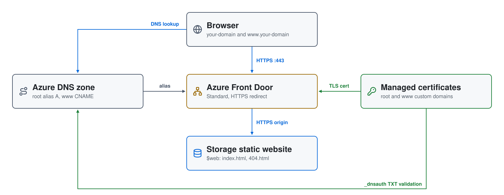

# Static Website on Azure: Storage + Front Door

A secure static website built with Terraform: the content lives in an
**Azure Storage static website**, **Azure Front Door** serves it over HTTPS
with Azure-managed certificates, and an **Azure DNS** zone points your domain
and `www` at Front Door. The only manual step is registering the domain.


| Piece | Where | Role |
|---|---|---|
| **Storage account** | `<domain>-website-rg`, Central US | Standard LRS; static website in `$web` with `index.html` and `404.html` |
| **Front Door** | global | `mcs-fd-profile`, `Standard_AzureFrontDoor`; origin is the storage web endpoint over HTTPS; redirects HTTP to HTTPS; the default `*.azurefd.net` name is off |
| **Custom domains** | Front Door | the root domain and `www`, each with an Azure-managed certificate |
| **Azure DNS zone** | your zone's resource group | root alias `A` record and `www` `CNAME` to Front Door, plus `_dnsauth` TXT records that validate the custom domains |

## Architecture

<picture>
  <source media="(prefers-color-scheme: dark)" srcset="architecture-dark.svg">
  
</picture>

Regenerate with `python3 make_diagram.py`.

**`01-website/`** is the whole stack: `storage.tf` (the account, the static
website and the two pages), `frontdoor.tf` (profile, endpoint, origin, route,
custom domains, and the validation TXT records, read back through the
`azapi` provider), and `dns.tf` (the root and `www` records).

## Prerequisites

* [A registered domain](https://learn.microsoft.com/en-us/azure/app-service/manage-custom-dns-buy-domain)
  with an Azure DNS zone. Registering it in the Azure portal creates the
  zone; the video walks through this step.
* [An Azure Account](https://portal.azure.com/)
* [Install AZ CLI](https://learn.microsoft.com/en-us/cli/azure/install-azure-cli)
* [Install Terraform](https://developer.hashicorp.com/terraform/install)

`check_env.sh` expects a service principal in `ARM_CLIENT_ID`,
`ARM_CLIENT_SECRET`, `ARM_SUBSCRIPTION_ID` and `ARM_TENANT_ID`. If this is
your first time watching our content, we recommend starting with this video:
[Azure + Terraform: Easy Setup](https://www.youtube.com/watch?v=wwi3kVgYNOk).

## Configure

Set your domain and its DNS zone's resource group in
`01-website/variables.tf`; the defaults are the author's:

| Variable | Default |
|---|---|
| `domain_name` | `mikes-cloud-solutions.org` |
| `dns_resource_group` | `mikes-solutions-org` |
| `web_location` | `Central US` |

## Deploy

```bash
git clone https://github.com/mamonaco1973/azure-website.git
cd azure-website
./apply.sh
```

Front Door's certificate issuance takes the longest. `apply.sh` ends by
running `validate.sh`, which checks `https://www.<domain>` once a minute
until it returns HTTP 200.

## Try it

Open `https://your-domain` or `https://www.your-domain`: the "Under
Construction" page from `01-website/index.html`. Any missing path returns
`404.html`.

## Troubleshooting

| Symptom | Fix |
|---|---|
| `validate.sh` keeps waiting | The managed certificates are still being issued; Front Door can take a while to validate the `_dnsauth` records and deploy. |
| The domain never validates | The DNS zone must be authoritative: the registrar's name servers must match the zone's NS records. |
| `destroy.sh` fails deleting DNS records | New Azure domains can carry a **Delete** lock. Remove it in the DNS zone's **Locks** blade, then run `destroy.sh` again. |

## Teardown

```bash
./destroy.sh     # destroys everything Terraform built; the domain and DNS zone stay
```

## Notes

- The storage account's static website endpoint is also public; Front Door
  is the intended way in, but nothing blocks direct access to the
  `*.web.core.windows.net` URL.
